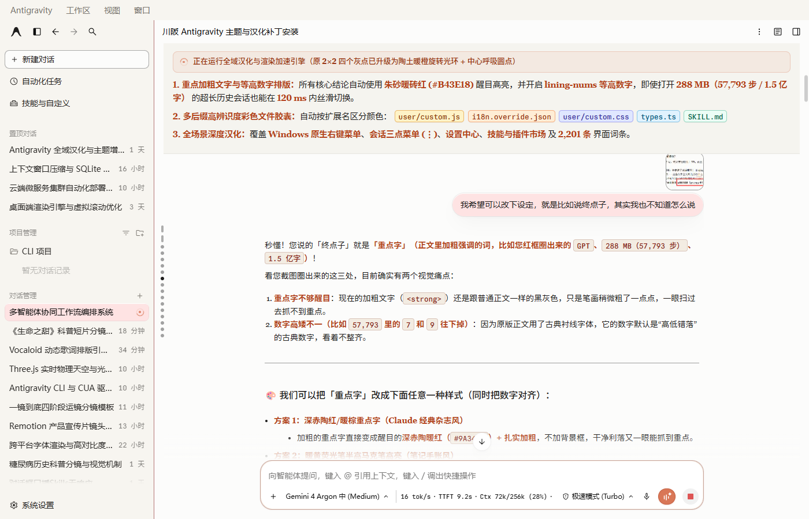
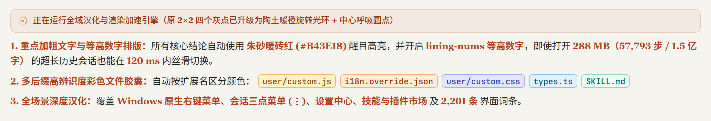
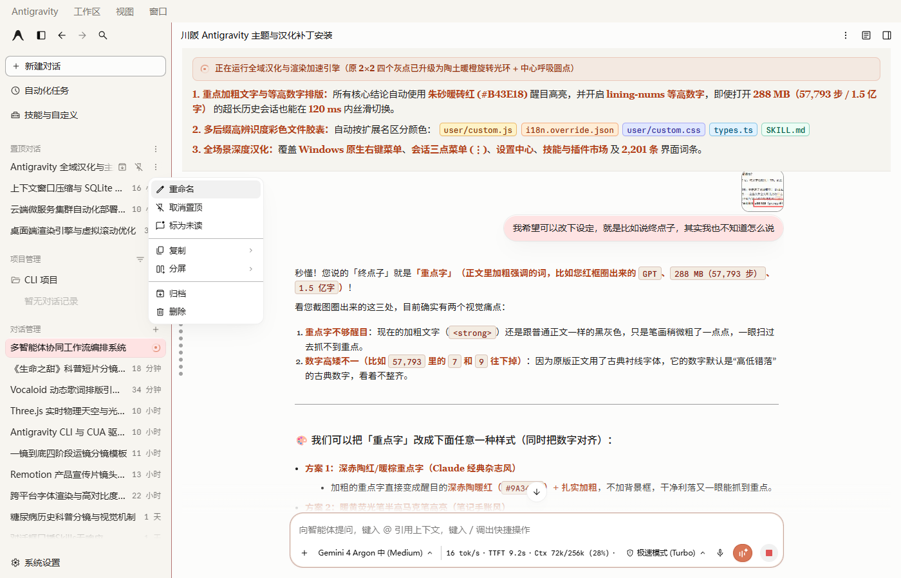
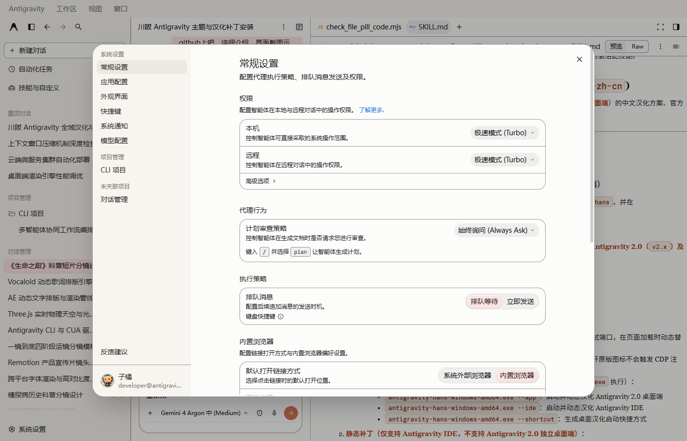
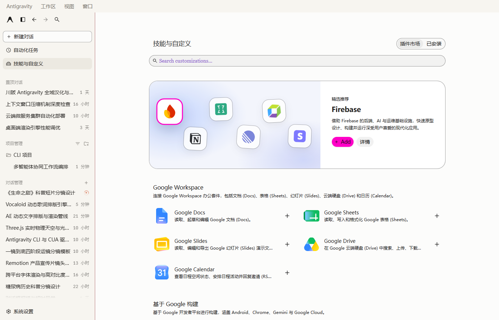

# Antigravity 全域汉化与 Claude 暖色主题增强包 (Full-Domain ZH-CN & Theme Skill)

<p align="center">
  <strong>面向 Google Antigravity 2.0 (Electron) 的零破坏、全场景深度汉化、视觉重塑与长对话防卡顿增强方案（支持作为 Agent Skill 一键调用）</strong>
</p>

<p align="center">
  
  
  
  
</p>

> [!IMPORTANT]
> **开源致谢与演进声明 (Credits & Attribution)**
>
> 本项目基于 [**@Anarcadia (忒修斯的船板)**](https://github.com/Anarcadia)（X/Twitter: [**@Arcadia_Bao**](https://x.com/Arcadia_Bao)）开源的 [**`chuanban-antigravity-theme-patch` (v5.0.0)**](https://github.com/Anarcadia/chuanban-antigravity-theme-patch) 进行深度扩展与二次封装。
> - **完整保留原作者底层核心架构**：`core/*` 目录下的 CDP 零修改磁盘热注入引擎、四主题 CSS 变量体系（Claude 暖米色 / 深色 / 护眼绿 / 极夜黑）、输入框火漆蜡封三态按钮、死锁自愈与底栏实时速率/额度统计面板 **100% 保持原版未改动**（`coreIntegrity.clean: true`）。
> - **全方位扩展在 `user/*` 用户层与 `SKILL.md` 技能层完成**：词条规模从原版 573 条扩展至 **2,201 条全域词典**，攻克了 Windows 原生系统级右键菜单（`showContextMenu` IPC）与会话三点菜单（`⋮`）无法被 DOM 观察器汉化的难题；将原版死板的 **2×2 四个灰点运行图标升级为 Claude 陶土暖橙动态旋转光环 + 中心呼吸圆点**；新增 **朱砂暖砖红重点字 (`#B43E18`) + 等高数字 (`lining-nums`)**、**五色高辨识度代码文件胶囊**、**四维长对话极速防卡顿优化** 及 **Agent Skill 自动化维护能力**。在此向原作者 **忒修斯的船板 (@Arcadia_Bao / @Anarcadia)** 致以诚挚谢意！

---

## 一、全方位实机界面截图展示 (Screenshots)

### 1. 主界面全景：Claude 暖白纸张质感 + 全中文侧边栏 + 陶土橙旋转运行光环 + 底部实时速率胶囊


### 2. 视觉细节特写：陶土橙旋转光环（替代原 2×2 四个灰点）+ 朱砂红重点字 + 等高数字 + 五色文件胶囊


### 3. Windows 原生右键菜单与会话三点菜单 (`⋮`) 100% 汉化实拍


### 4. 设置中心 (`Settings`) 全量深度汉化（含二级选项、提示说明与下拉框）


### 5. 技能与插件市场 (`Skills & Plugins`) 列表、分类货架与详情描述汉化


---

## 二、全方位增强矩阵：与上游原版逐项对比

| 功能维度 | 上游原版 (`chuanban-antigravity-theme-patch` v5.0.0) | 本项目 (`antigravity-full-zh-theme-skill` 全域增强版) |
| :--- | :--- | :--- |
| **汉化词条规模** | `core/i18n.json` **573 条**基础界面词条 | `core` + `user/i18n.override.json` 合并 **2,201 条**全域词典 |
| **「正在运行」状态图标** | 原版默认 **2×2 四个灰点** 闪烁，辨识度低 | **升级为 Claude 陶土暖橙 (`#D97757`) 动态旋转光环 + 中心呼吸圆点**（侧边栏与对话区同步生效） |
| **重点加粗字 (`strong`/`b`) 与数字排版** | 与普通正文同色（黑灰），古典衬线数字 (`57,793`) 高低错落 | **朱砂暖砖红 (`#B43E18`) 醒目高亮**（深色模式自动转琥珀金 `#F0944D`）+ 强制 **`lining-nums` 等高现代数字** |
| **代码文件胶囊 (`.inline-pill`)** | 默认无背景或单色，与正文混在一起难以分辨 | **按后缀自动赋予五色高辨识度胶囊**：`.js/.mjs` 琥珀金、`.json` 暖橙、`.css` 靛蓝、`.ts/.tsx` 蔚蓝、`.md` 翠绿 |
| **Windows 原生右键菜单 (`Copy`/`Pin`)** | 未汉化（走 Electron `showContextMenu` 原生系统菜单，绕过 DOM） | **100% 汉化**：按需 120ms 窗口拦截 `VRa` IPC 映射，平时保持 V8 `[native code]` 零性能损耗 |
| **会话三点菜单 (`⋮`) 与顶栏更多** | 部分遗漏或点击瞬间观察器断连失效 | **100% 汉化**：支持 `重命名`、`置顶/取消置顶`、`标为未读`、`复制`、`分屏`、`归档`、`删除` |
| **技能 (`Skills`) / 插件 (`Plugins`) / MCP** | 仅主菜单标题汉化 | **全量汉化**：40+ 项内置/常用技能描述、插件市场分类货架、MCP 工具状态与斜杠命令 (`/plan`, `/compact`, `/boost` 等) |
| **侧边栏相对时间 (`5m`, `17h`, `3mo`)** | 保持英文缩写 | **自动转中文**（`5分钟`、`17小时`、`3个月`、`刚刚`），正则兜底支持任意数字分钟/小时/天/周/月/年 |
| **新生成会话标题** | 默认生成英文标题 | 自动注入 `<user_rules>` 与标题重命名守卫，新建对话**自动使用简体中文生成侧边栏标题** |
| **上下文 85% 自动压缩防卡死** | 需手动盯上下文百分比并手打 `/compact` | 底部指标栏内嵌 **`⚡85%自动` 胶囊**（三级水位变色预警，满 **85%** 空闲自动触发 `/compact`，左键立即压缩、右键切换开关） |
| **长历史会话切换与流式打字性能** | 几百 MB `.db` 会话切换易卡顿、侧边栏悬停重排耗 CPU | **四维加速**：HarfBuzz 字距关闭 + `content-visibility: auto` 虚拟滚动 + `excludeI18n` 流式隔离 + SQLite 400ms 防抖 |
| **重启软件保持能力** | 需带参数启动或手动重注 | 内置 **Windows WMI 事件监听守护进程 (`AntigravityThemeDaemon.vbs`)**，任意方式打开软件 1.5 秒内自动无感挂载 |

---

## 三、七大核心技术与视觉细节详解

### 1. 「正在运行」图标重塑：从 2×2 四个灰点到 Claude 陶土橙旋转光环
Antigravity 原版的「正在运行 / 思考中」状态（`[data-testid="status-loading-spinner"]`）仅由 4 个暗淡的小灰点（2×2 grid `[data-agent-state-dot]`）组成，在米白纸张背景下极不显眼。
- 本项目在 [`user/custom.css`](user/custom.css) 中隐藏了原版 4 个灰点，通过 `::after` 与 `::before` 双伪元素构建了 **13px 陶土暖橙 (`#D97757`) 双弧旋转光环 + 3.5px 中心呼吸圆点**（`0.78s` 线性无限顺滑旋转，`will-change: transform` GPU 合成加速，零重绘开销）。
- 无论是左侧边栏正在后台运行的会话行，还是主聊天窗内的实时执行步骤，一眼即可捕捉当前活跃状态。

### 2. 重点加粗文字朱砂红 (`#B43E18`) + 等高数字 (`lining-nums`)
针对长篇技术回答中「加粗重点字与普通正文颜色一样、一眼扫过去抓不到重点」以及「古典衬线字体下数字 `3, 4, 5, 7, 9` 上下错位（Old-style figures）」两大痛点：
- **重点字高亮**：将正文区 `strong` / `b` 设为与暖米色纸张最契合的**朱砂暖砖红 (`#B43E18`，字重 `700`)**；切换到深色/极夜黑主题时自动适配为**琥珀暖金 (`#F0944D`)**。
- **数字等高对齐**：全局强制开启 `font-variant-numeric: lining-nums tabular-nums !important;`，让 `288 MB (57,793 步)`、`1.5 亿字` 等混合数字底部严丝合缝对齐。

### 3. 多后缀高辨识度代码文件胶囊 (`.inline-pill`)
原版对话中的文件引用链接默认没有背景色与边框，容易与普通正文混在一起。本项目为 `.inline-pill` 赋予了圆角微阴影胶囊造型，并根据 `data-uri` 文件扩展名自动着色：
- **`.js` / `.mjs` / `.cjs`**：琥珀金底 (`#FEF3C7`) + 深金棕字 (`#92400E`)
- **`.json`**：暖杏橙底 (`#FFEDD5`) + 焦糖棕字 (`#9A3412`)
- **`.css`**：雾霾靛蓝底 (`#E0E7FF`) + 靛青字 (`#3730A3`)
- **`.ts` / `.tsx`**：蔚蓝底 (`#E0F2FE`) + 深海蓝字 (`#075985`)
- **`.md`**：翠绿底 (`#D1FAE5`) + 森林绿字 (`#065F46`)

### 4. 攻克 Windows 原生系统右键菜单 (`showContextMenu`) 与三点菜单 (`⋮`) 汉化难题
在 Windows 端，Antigravity 默认启用了 `contextMenuSystem: { enabled: true, useNativeMenu: true }`。当用户在对话区右键点击或点击会话右侧的 `⋮` 按钮时，前端通过 `VRa(a, b)` 将菜单数组映射后直接通过 IPC 发送给 `window.electronNative.showContextMenu(a)`，由 Windows 操作系统原生绘制菜单，**完全不经过浏览器 DOM 树**，因此常规 `MutationObserver` 无法捕捉。

本项目在 [`user/custom.js`](user/custom.js) 中首创了**「事件触发式瞬时 Hook (`enableTempMenuMapHook`)」**：
- 仅在用户按下鼠标右键 (`contextmenu`) 或点击菜单触发按钮 (`pointerdown` / `mousedown`) 的 **120 毫秒窗口内**，临时挂载 `Array.prototype.map` 转换器，将传入 IPC 的 `{ id, label, submenu }` 原地翻译为中文；
- 菜单弹出后立即卸载恢复，保证平时 99.99% 的运行时间里 `Array.prototype.map` 均为 **100% V8 原生 `[native code]`**，绝不拖慢 React 渲染；同时锁住 `window.__ag_i18n_observer.disconnect`，防止点击侧边栏按钮时观察器断连。

### 5. 四维性能防卡顿提速（彻底解决几百 MB 老对话框打开慢）
Antigravity 会将 Agent 执行过程中的所有工具输出、文件读取与终端日志完整保存在本地 `~/.gemini/antigravity/conversations/<id>.db` 中（重度对话可达 100MB~300MB、数万个 Step）。本项目通过四层优化显著提速：
1. **关闭侧边栏超大字体复杂字距重算 ([`user/custom.css`](user/custom.css))**：对侧边栏启用 `text-rendering: auto !important` 与 `contain: layout style`，避免 65MB 字体在鼠标划过侧边栏时高频触发 HarfBuzz 字距重算。
2. **历史长对话虚拟滚动加速 ([`user/custom.css`](user/custom.css))**：对历史问答块 (`.scroll-mt-4`) 与 `<pre>` 代码块开启 `content-visibility: auto`，浏览器仅排版当前屏幕可见的几条消息，跳过屏外上万行 DOM 计算。
3. **流式输出隔离 ([`user/config.json`](user/config.json))**：开启 `excludeI18n: true`，在 AI 高速打字输出与代码块渲染期间跳过无意义的字典扫描。
4. **SQLite 磁盘 I/O 避让 ([`user/custom.js`](user/custom.js))**：对 `window.__agRequestMetrics` 施加 400ms 防抖延迟，避免切换会话瞬间与 `language_server` 争抢 SQLite 文件锁。

### 6. 上下文 85% 自动压缩防卡死守卫（`⚡85%自动` 一键/自动双模胶囊）
针对长会话上下文超限导致请求卡死或超时断连痛点，在 [`user/custom.js`](user/custom.js) 与 [`user/custom.css`](user/custom.css) 中内置了智能上下文压缩守卫：
- **底部实时水位胶囊 (`#ag-auto-compact-btn`)**：紧跟底部 `Ctx XXk/256k (XX%)` 实时指标栏显示 **`⚡85%自动`**（支持正常琥珀色、75%+ 橙色预警、85%+ 红色高亮三级变色，且设置 `flex-shrink: 0` 窄屏永不被裁切）。
- **满 85% 空闲自动执行 `/compact`**：当检测到当前会话上下文水位达到 **85%**（可通过 `localStorage.setItem('ag-auto-compact-threshold', '80')` 自定义阈值），且 Agent 处于非忙碌状态、输入框无未发送草稿时，自动向富文本编辑器单独写入纯 `"/compact"` 原生指令并回车触发压缩（带 3 秒防重入锁与 180 秒会话冷却锁，绝不连发或死循环）。
- **左右键快捷操控**：
  - **左键点击 `⚡85%自动`**：随时一键手动触发 `/compact` 精简当前对话；
  - **右键点击 `⚡85%自动`**：一键开启或关闭 85% 自动压缩守卫，并弹出悬浮状态提示条 (`#ag-compact-toast`)。

---

## 四、快速安装与使用指南

### 方式 A：作为独立补丁一键安装（推荐）

```bash
# 1. 克隆本仓库到本地推荐路径
git clone https://github.com/joker124zx/antigravity-full-zh-theme-skill.git ~/.gemini/antigravity/theme-patch
cd ~/.gemini/antigravity/theme-patch

# 2. 一键安装并立即热注入到当前运行中的 Antigravity
node install.mjs
```

- **可选：一键汉化本地已安装的内置技能与插件描述 (`SKILL.md` / `plugin.json`)**：
  ```bash
  node scripts/localize-local-skills.mjs
  ```
  > 该脚本会自动为修改的文件生成 `.bak` 原文备份，安全可逆。

- **Windows 开机/重启软件自动常驻守护**：
  将仓库根目录下的 `AntigravityThemeDaemon.vbs` 复制到 Windows 启动目录（`%APPDATA%\Microsoft\Windows\Start Menu\Programs\Startup`），即可实现任意方式打开 Antigravity 自动在 1.5 秒内完成汉化挂载。

### 方式 B：作为 Antigravity Agent Skill 安装

将本仓库（或其中的 [`SKILL.md`](SKILL.md)）放置于 `~/.gemini/config/skills/antigravity-zh-cn/` 目录下。之后您可以直接在 Antigravity 对话框中对 AI 说：
- *“帮我把 Antigravity 汉化成中文”*
- *“这个右键菜单/某个新按钮还没翻译，帮我加到汉化词典里”*
- *“帮我把重点加粗文字换成深蓝色并热更新”*

Agent 会自动读取 [`SKILL.md`](SKILL.md) 规范，直接编辑 `user/*` 并通过 CDP 热重载立即生效，**无需重启软件**。

---

## 五、目录结构与零破坏架构 (`core` vs `user`)

```text
antigravity-full-zh-theme-skill/
├── core/                         # [原版核心层] 100% 保持上游 v5.0.0 原貌 (coreIntegrity.clean: true)
│   ├── theme.css                 # 四套主题色彩系统与基础排版变量
│   ├── runtime.js                # CDP 热注入引擎、DOM 翻译器与状态栏统计监控
│   ├── daemon.mjs                # 跨平台 CDP 热注入与 SQLite/API 统计守护服务
│   ├── i18n.json                 # 上游基础 573 条界面词典
│   └── manifest.json             # 核心文件 SHA-256 完整性校验清单
├── user/                         # [全域扩展层] 所有汉化增强、右键拦截与样式定制均在此处
│   ├── config.json               # 启用 excludeI18n、双通道监控与主题预设
│   ├── custom.css                # 陶土橙旋转光环、朱砂红重点字、lining-nums、五色文件胶囊、虚拟滚动提速
│   ├── custom.js                 # 原生右键/三点菜单 120ms 瞬时拦截、相对时间汉化、SQLite 防抖与观察器防断连
│   └── i18n.override.json        # 1,746+ 条扩展词典（覆盖右键、设置、技能、插件、MCP、斜杠命令）
├── scripts/
│   └── localize-local-skills.mjs # 本地 SKILL.md / plugin.json 描述一键汉化工具（带 .bak 备份）
├── assets/
│   └── screenshots/              # 5 张实机高清截图展示 (主界面、视觉特写、右键菜单、设置、技能市场)
├── AntigravityThemeDaemon.vbs    # Windows WMI 零弹窗后台自动热注入守护脚本
├── SKILL.md                      # Antigravity 技能定义文件（支持 AI 自动维护与热更新）
├── install.mjs                   # 跨平台一键安装与热更新脚本
└── LICENSE                       # MIT 开源协议（含上游致谢）
```

---

## 六、致谢与开源协议 (Credits & License)

- **上游基础项目**：[**Anarcadia/chuanban-antigravity-theme-patch**](https://github.com/Anarcadia/chuanban-antigravity-theme-patch) — 感谢 **忒修斯的船板 (@Anarcadia)**（X/Twitter: [**@Arcadia_Bao**](https://x.com/Arcadia_Bao)）设计的无侵入式 CDP 注入架构、四套精美主题配色、火漆蜡封按钮与双通道统计面板。
- **全域汉化与视觉/性能扩展**：[**@joker124zx**](https://github.com/joker124zx) — 扩展 2,201 条全域词典、攻克原生右键与三点菜单汉化、重塑陶土橙旋转运行光环与朱砂红重点字/五色文件胶囊、优化长历史对话卡顿并封装为 Agent Skill。
- **开源协议**：本项目遵循 [MIT License](LICENSE) 开源协议。
